# P：一般写真・連続階調画像

写真、滑らかなグラデーション、細部を含むイラストなど、連続階調を持つ素材で効果を確認しやすいエフェクトです。

[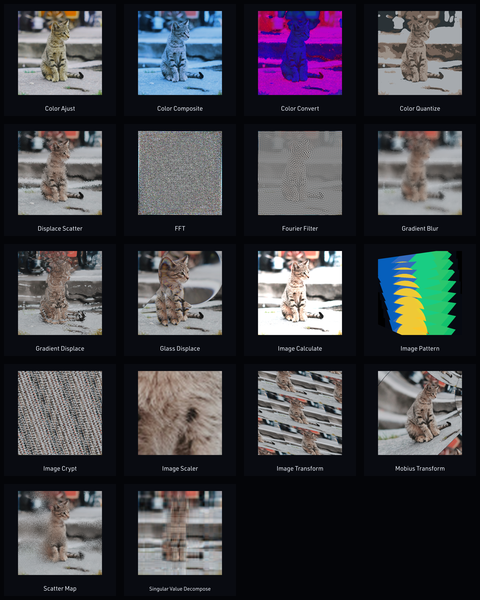](assets/overview/photo.png)

## AOD_ColorAjust

- **分類:** P：一般写真・連続階調画像

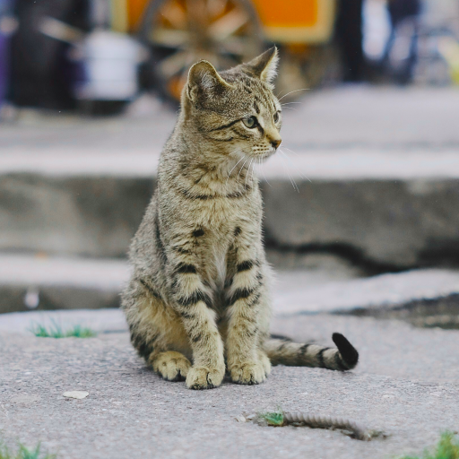

OKLCH、OKLAB、LAB、HSLなどの色空間で、色相・彩度感・明るさを調整します。

### パラメーター

- `Color Space`: 調整に使用する色空間を選択します。
- `Hue Shift`、`Chroma Scale`、`Lightness Delta`: 色相の回転、彩度成分の倍率、明度差を設定します。
- `Clamp to sRGB`: 出力をsRGB範囲へ制限します。
- `Fallback Preview`: 未対応の組み合わせを確認するためのフォールバック表示です。

## AOD_ColorComposite

- **分類:** P：一般写真・連続階調画像

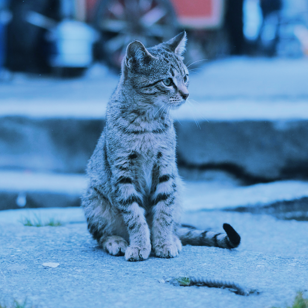

複数の色またはレイヤーを、指定した描画モードと不透明度で順番に合成します。

### パラメーター

- `Number of Composite Inputs`、`Add/Remove Composite`: 合成スロット数を管理します。
- 各`Composite`: 色／レイヤー入力、標準または高度な描画モード、不透明度を設定します。
- `Show Advanced Blend Modes`: 高度な描画モード群の表示を切り替えます。

## AOD_ColorConvert

- **分類:** P：一般写真・連続階調画像

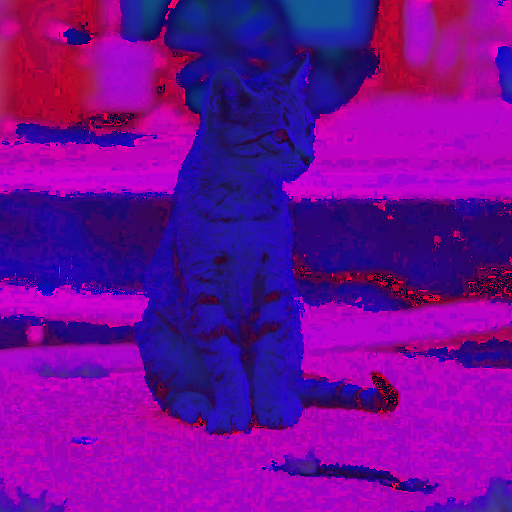

RGBとOKLAB、OKLCH、LAB、YIQ、YUV、HSL、HSV、CMYKなどの色空間を相互変換します。

### パラメーター

- `From Color Space`、`To Color Space`: 入力値と出力値の色空間を選択します。
- `Clamp Output 0..1`: 変換結果を0〜1へ制限します。
- `Fallback Preview`: 変換値を画面上で確認しやすくする補助表示です。

### 補足

色空間によっては出力チャンネルが表示用RGBではなくデータ値を表すため、見た目より数値利用を目的とする場合があります。

## AOD_ColorQuantize

- **分類:** P：一般写真・連続階調画像

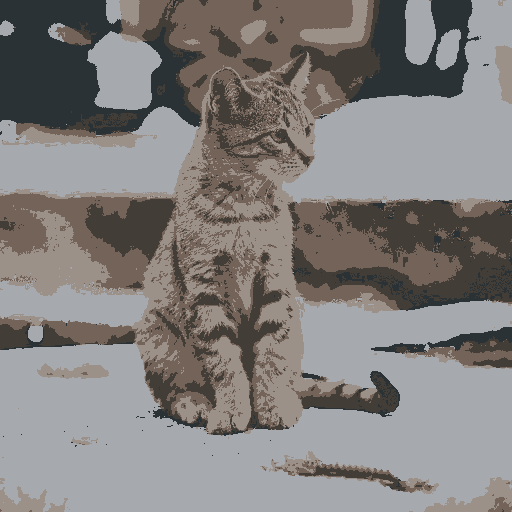

k-means／g-means系のクラスタリングで画像の色数を減らします。

### パラメーター

- `Cluster Method`、`Colors (K)`、`Auto Max Clusters`: クラスタリング方式と色数を指定します。
- `Max Iterations`、`Seed`、`Init Method`: 反復回数、乱数、初期化方式を設定します。
- `Color Space`: 色差の計算空間を選択します。
- `Area Similarity Threshold`、`g-means Alpha`、`Selected Colors`: 自動分割や指定色クラスタの条件を調整します。
- `RGB Only`、`Use GPU`: アルファ保持とGPU処理を切り替えます。

## AOD_DisplaceScatter

- **分類:** P：一般写真・連続階調画像（補助入力: D）

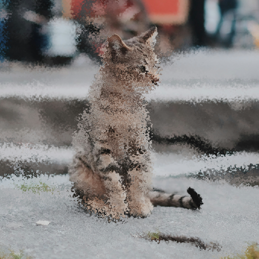

手続き的なベクトル場と任意マップを使い、画像を連続的に変位・散乱させます。

### パラメーター

- `Scatter Amount`、`Complexity`、`Scatter Algorithm`: 変位量、ノイズ複雑度、散乱方式を設定します。
- `Sampling Distribution`、`Distribution Shape`、`Grain Size`: サンプリング分布と粒度を調整します。
- `Noise Offset`、`Noise W`、`Seed`: ノイズ場の位置、時間軸相当の値、乱数を設定します。
- `Scatter/Grain/Noise Offset Map`: 量・粒度・ノイズ位置をレイヤーまたは入力画像から制御します。
- `Direction`、`Anisotropy`とそのマップ: 散乱方向と異方性を指定します。
- `Texture`: テクスチャ入力、チャンネル、影響度を設定します。
- `Edge Mode`、`Blend Opacity`、`Preserve Alpha`、`Clamp`: 境界処理と最終合成を制御します。

## AOD_FFT

- **分類:** P：一般写真・連続階調画像

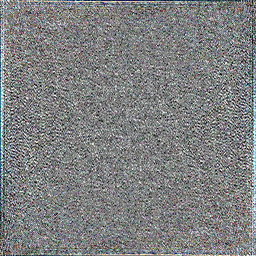

画像に2次元高速フーリエ変換を適用し、実部または虚部のスペクトルを出力します。

### パラメーター

- `Output`: 実部／虚部を選択します。
- `Process Width/Height`: FFT処理解像度を指定します。0では入力サイズを使用します。
- `Offset`、`Scale`: 係数を表示・保存するためのオフセットと倍率です。
- `RGB Only`、`Raw Mode`: アルファ保持と32bpcの生係数出力を切り替えます。

### 補足

正確なIFFT再構成には32bpcのRaw Modeが適しています。

## AOD_FourierFilter

- **分類:** P：一般写真・連続階調画像（補助入力: D）

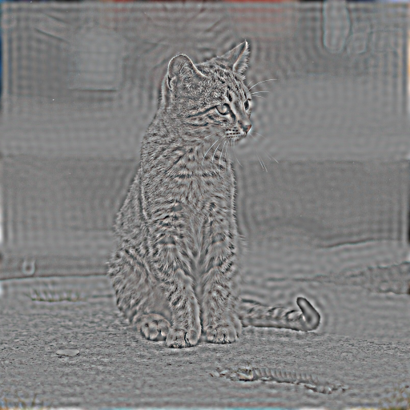

周波数領域のフィルターとマスクを使って、輪郭・低周波・方向成分などを整形します。

### パラメーター

- `Color Space`、`Process Width/Height`、`Target Channels`: 処理空間、解像度、対象チャンネルを指定します。
- `Filter Type`と`Param A–D`: フィルター方式と主要係数を設定します。
- `Param A–D X/Y`: X・Y方向を分離した係数を設定します。
- `Mask Layer/Channel/Strength`、`Invert/Swap Quadrants`: スペクトルマスクの入力と扱いを制御します。
- `Mix`、`Output Gain`、`Use GPU`、`Clamp`: 原画像との混合、出力倍率、GPU、範囲制限を設定します。

## AOD_GradientBlur

- **分類:** P：一般写真・連続階調画像（補助入力: D）

画像または別マップの輝度・RGB・色相彩度の勾配方向に沿って方向性ブラーを適用します。

### パラメーター

- `Vector Mode`、`Gradient Source`: ベクトルの解釈方法と勾配元を選択します。
- `Map Layer`: 別レイヤーを方向マップとして使用します。
- `Blur Radius`、`Samples`、`Strength`: ブラー距離、品質、影響度を設定します。
- `Edge Mode`、`Preserve Alpha`: 境界処理とアルファ保持を制御します。

## AOD_GradientDisplace

- **分類:** P：一般写真・連続階調画像（補助入力: D）

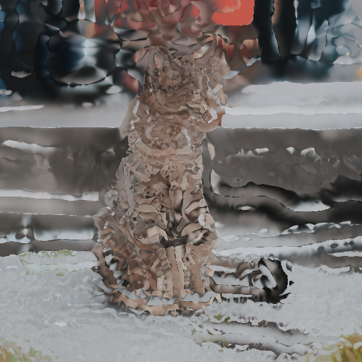

画像またはマップから得た勾配ベクトルに沿ってピクセルを変位させます。

### パラメーター

- `Vector Mode`、`Gradient Source`、`Map Layer`: 変位ベクトルの方式と入力を選択します。
- `Distance`、`Strength`: 移動距離と効果量を設定します。
- `Edge Mode`、`Preserve Alpha`: 画像外の扱いとアルファ保持を制御します。

## AOD_GlassDisplace

- **分類:** P：一般写真・連続階調画像（補助入力: D）

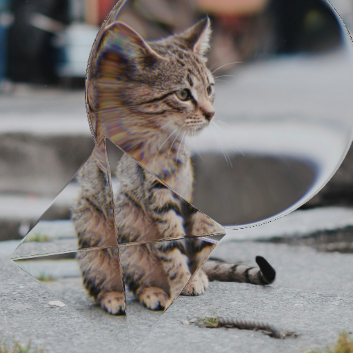

手続き形状または任意マップから高さと法線を求め、光学的なガラス屈折、割れ・破片形状、連続スペクトルの色分散を画像へ適用します。

### パラメーター

- `Height Source`、`Custom Map Layer`、`Map Channel/Black/White/Invert`: 手続き形状、入力画像、別レイヤーから高さ場を選択します。
- `Shape`、`Center`、`Size/Aspect/Rotation`: 基本形状、全画面Facet／Fractured Field、中心衝撃型Impact Glassを設定します。
- `Cell Size/Relief/Irregularity`、`Crack Width/Depth`、`Radial Cracks/Branching/Stress Rings`: セル面と放射亀裂・分岐・応力リングを調整します。
- `Normal Strength/Radius`、`Refraction`: 高さ勾配から界面法線を作り、Snellの法則に基づく屈折変位を設定します。
- `Chromatic Dispersion`、`Auto Spectral Steps`、`Spectral Steps (Manual)`: N-BK7相当の波長依存屈折率とCIE 1931応答を使う色分散の強さ・積分精度を設定します。自動時は手動段数が無効になります。
- `Sampling`、`Edge`、`Mix`、`Preserve Input Alpha`: 補間、画像外処理、最終合成を制御します。
- `View`、`Clamp (32bpc)`: Final、Height、Normal、Displacement、Facet IDの確認出力と範囲を切り替えます。

## AOD_ImageCalculate

- **分類:** P：一般写真・連続階調画像

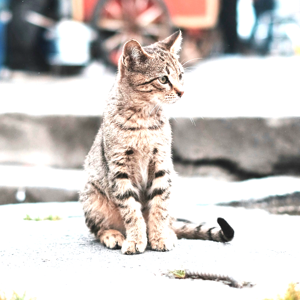

1枚または複数レイヤーに、Blender Math風の算術・比較・三角関数処理を適用します。

### パラメーター

- `Operation`: 加減乗除、指数、比較、丸め、三角関数などの演算を選択します。
- `Input B/C`、`Layer B/C`、`Value B/C`: 第2・第3引数を数値またはレイヤーから指定します。
- `Epsilon`: 除算や比較で使用する微小値です。
- `Channel`、`Calculation Color Space`: 対象チャンネルと演算空間を選択します。
- `Clamp Result`、`Use Original Alpha`: 出力範囲とアルファを制御します。

## AOD_ImageCrypt

- **分類:** P：一般写真・連続階調画像

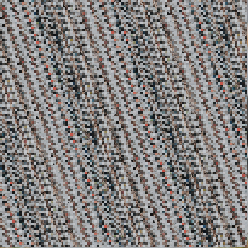

同じ画像寸法とキーを使い、画素位置・ブロック・チャンネル・ビットプレーンを決定的にスクランブル／復元します。破損耐性を優先する非可逆の視覚フォーマットも備えます。

### パラメーター

- `Operation`: Encode／Decodeを切り替えます。
- `Algorithm`: Coordinate Shear、Block Permutation、Affine Channel Cipher、Combined Legacy、Linear Interleave、Bit-Plane Cipher、Interleave + Bit-Plane、Resilient Replicasを選択します。
- `Key A–D`、`Rounds`: 4語のキーと反復回数を設定します。
- `Block Size`: Block Permutation／Combined Legacyのブロック単位を設定します。
- `Cipher Precision`、`Channels`: チャンネル暗号化の量子化精度とRGB／RGBA対象を指定します。
- `Recovery Redundancy`、`Recovery Interleave`: Resilient Replicasの多重化数と空間分散回数を指定します。

### 補足

機密保護用の暗号ではなく、モーショングラフィックスやグリッチ表現向けの可逆変換です。厳密な復元には同一寸法・ビット深度・キー・設定と、途中で未加工のエンコード画像が必要です。Resilient Replicasは論理解像度を下げる代わりに、局所的な画素破損を中央値で復元するlossy方式です。

## AOD_ImageScaler

- **分類:** P：一般写真・連続階調画像

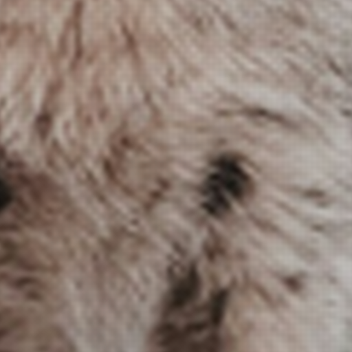

補間方式・アンカー・画像外処理を指定して、画像を高品質に拡大・縮小します。

### パラメーター

- `Scale Mode`、`Use Reciprocal`、`Scale`: パーセント、指数、2の累乗などの倍率指定を切り替えます。
- `Separate X/Y Scale`: X・Yを個別に拡縮します。
- `Anchor XY`、`Outside Pixels`: 拡縮中心と画像外ピクセルの扱いを指定します。
- `Interpolation`: 最近傍、バイリニア、バイキュービック、Lanczosなどを選択します。
- `Mitchell B/C`、`Lanczos Lobes`、`EQA Radius`: 選択した補間カーネルを調整します。

## AOD_ImageTransform

- **分類:** P：一般写真・連続階調画像

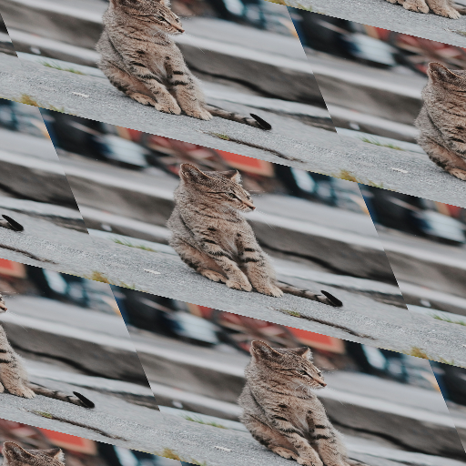

AE標準Transformに近いアフィン変換を、多様な再構成フィルターと画像外サンプリングで適用します。

### パラメーター

- `Anchor Point`、`Position`、`Scale`／`Separate Dimensions`: 変換基準、移動、均一またはX／Y個別倍率を指定します。
- `Rotation`、`Skew`、`Skew Axis`、`Opacity`: 回転、傾斜方向、不透明度を設定します。
- `Interpolation`: Nearest、Bilinear、Bicubic、Mitchell-Netravali、Lanczos、Cubic B-Spline、EWA Quadraticを選択します。
- `Mitchell B/C`、`Lanczos Lobes`、`EWA Radius`: 選択中カーネルの形状を動的UIで調整します。
- `Sample Outside Image`、`Outside Pixels`: 画像外を透明にするか、Clamp／Tile／Mirrorで補間するかを切り替えます。

## AOD_MobiusTransform

- **分類:** P：一般写真・連続階調画像

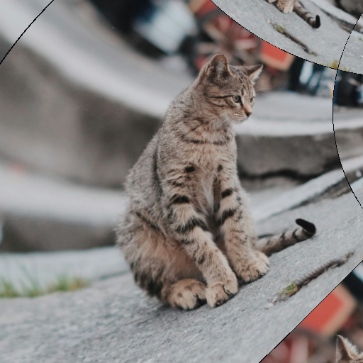

複素係数によるメビウス変換で、画像を円弧状・反転状にワープします。

### パラメーター

- `a.re/im`、`b.re/im`、`c.re/im`、`d.re/im`: 変換式 `(az+b)/(cz+d)` の複素係数です。
- `Use Layer Center`、`Center`、`Scale`: 座標系の中心とスケールを設定します。
- `Edge`、`Interpolation`、`Anti-alias`、`Mipmap Bias`: 境界、補間、品質を調整します。

## AOD_ScatterMap

- **分類:** P：一般写真・連続階調画像（補助入力: D）

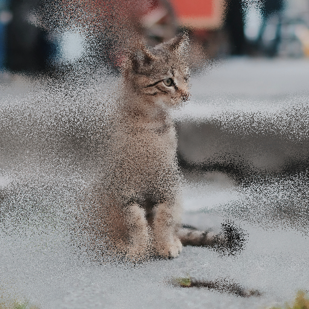

マップ制御のGather／Swap方式で、ピクセルまたは粒単位の散乱を適用します。

### パラメーター

- `Scatter Mode`、`Amount`、`Radius`、`Grain Size`、`Gather Samples`: 散乱方式と基本量を設定します。
- `Direction`、`Anisotropy`: 散乱分布を方向性のある楕円へ変形します。
- `Grain Kernel`: 形状、サイズ／位置／形状ランダム、密度、カスタムテクスチャを設定します。
- `Fill`、`Fill Opacity`: 粒内部を元テクスチャ、平均、中央値、中心色で塗る方法を選択します。
- `Amount/Radius/Grain Size/Anisotropy Map`: 各値を入力画像または別レイヤーから制御します。
- `Seed`、`Temporal Mode`、`Edge Mode`: 再現性、フレーム変化、境界処理を指定します。
- `Blend Opacity`、`Preserve Original Alpha`、`Clamp`: 原画像との合成と出力を制御します。

## AOD_ImagePattern

- **分類:** P：一般写真・連続階調画像

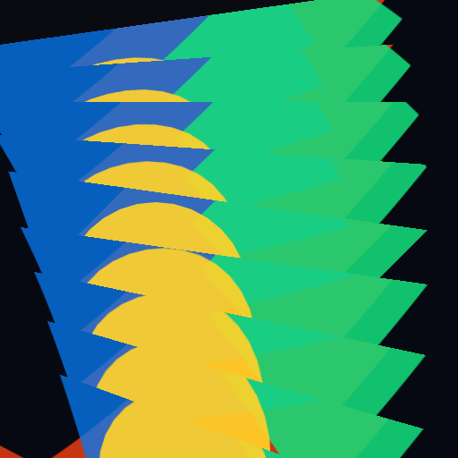

フィードバック、万華鏡、帯状リピート、隙間のない多角形タイルで画像パターンを作り、コピーごとに参照時刻をずらします。

### パラメーター

- `Pattern Mode`: Feedback／Polar Kaleidoscope／Strip Repeat／Polygon Tileを選択します。
- `Center`: 初期値はレイヤーの幅・高さの半分です。座標入力、ポイント選択、キーフレーム、エクスプレッションで直接指定できます。
- Feedbackの`Decay`: 既定値1.0。`Opacity (%)`、`Iterations`、回転・拡縮・移動、合成順序を調整できます。
- Stripの`Angle`、`Width (px)`、`Repeat`: 中心を通る帯を切り取り、法線方向へTile／Mirrorで繰り返します。Angle 0°は水平の帯です。
- Stripの`Clipping`: 両側（Both Edges、初期値）／負側のみ（Negative Edge Only）／正側のみ（Positive Edge Only）／なし（None）。Angle 0°では負側が上、正側が下です。開いた側には画像の続きを描画します。
- Stripの`Overlap Order`: クリッピング解除時の重なり順です。Overは反復番号の大きいスリットが手前、Underは小さいスリットが手前になり、元画像の透明度で合成します。
- Stripの`Strip Rotation`、`Strip Scale X/Y (%)`、`Strip Skew (deg)`、`Strip Skew Axis`: 帯の配置を回転・拡縮・せん断します。
- `Delta Angle`、`Delta Width (px)`、`Delta Mode`: 隣の帯と共有する境界線の角度と、Centerの法線上での境界間隔を変えます。Forward／Reverse／Outward／Ping Pong／Randomを選び、Cycle / RangeとSeedで折り返しや乱数を調整します。
- `Delta X (px)`、`Delta Y (px)`: 境界を維持したまま、帯ごとの内部画像をソース画像のX/Y座標でずらします。初期値0。ずらし量はDelta Modeに従い、Centerの帯が基準です。Time Originを動かしても位置ずれの基準は変わりません。
- Stripの`Split Overlaps`: オン（既定値）は交差した境界でも領域を分割します。オフはCenter側の領域へ戻ってくる境界を省き、重なった部分の追加分割を抑えます。省かれた反復の番号はMirrorとTime Deltaでも維持します。
- `Copies Each Side`: Delta Angle／Width使用時、またはクリッピング解除時の反復数です。1なら中心を含め3枚を描画します。Both Edgesでは境界間に幾何学的な隙間や重なりがなく、外側は透明です。Both EdgesかつAngle／WidthのDeltaが両方0なら、X/YのDeltaを使っていても無制限に反復します。
- Polygonの`Shape`、`Tile Width/Height (px)`: 三角形・四角形・六角形を隙間なく敷き詰めます。
- Polygonの`Repeat`、`Rotation`、`Scale X/Y (%)`、`Skew (deg)`、`Skew Axis`: Tile／Mirrorと格子全体の変形を調整します。
- `Image Affect (%)`／`Strip Image Affect (%)`: 0%はマスクのみ、100%は画像も変形します。途中の影響率にも調節できます。
- `Mix (%)`、`Sampling`、`Edge`: 原画像との混合、補間、画像外の扱いです。EdgeはNone (Transparent)／Extend／Tile／Mirror／Blackを選べます。None（既定）は画像外を透明に、Blackは不透明な黒にします。Blackでも画像内の透明部分は保持し、Time Deltaの参照画像にも適用します。
- Stripの`Edge Direction`: Along Stripは帯の方向に沿ってExtend／Tile／Mirrorを適用し、Image Axesは通常の画像端処理です。
- `Time Delta (frames)`、`Time Origin (i = 0)`、`Time Index Offset`: 基準から1段ごとの参照時刻差です。時間差の基準点はCenterと独立しています。Feedbackでは反復番号とIndex Offsetを使います。
- `Tile Time Direction`: Polygonの時間差を基準タイルからの段数／X方向／Y方向で選びます。`Time Edge`は範囲外の時刻をTransparent／Extend／Loop／Ping Pongで扱います。

### 補足

Polygon Tileの幾何学的な隙間はありません。入力の透明部分や画像外のサンプリングは元の透明度とEdge設定に従います。StripのDelta Angleは共有境界の間に画像を配置し、Image Affect 100%では画像の両端を境界に合わせます。Split Overlapsがオンの場合、境界が交差した箇所は法線方向の順序で領域を割り当てます。プレビューはSplit Overlapsオフ、両側クリップ、EdgeをBlackに設定しています。Blackはクリッピング解除時に他のコピーを覆うことがあります。三角形のCenterは重心です。

Time Delta使用時は境界の並び順と直近の参照画像を再利用します。改善幅と測定条件は[ImagePatternの説明](../../plugins/image-pattern/README.md)の「Time Deltaの処理速度」を参照してください。

PatternTransformからの改名に伴いWave Lattice／Complex Mapを削除しています。旧インスタンスはImagePatternを追加して設定を移してください。詳細は[ImagePatternの説明](../../plugins/image-pattern/README.md)を参照してください。

## AOD_SingularValueDecompose

- **分類:** P：一般写真・連続階調画像

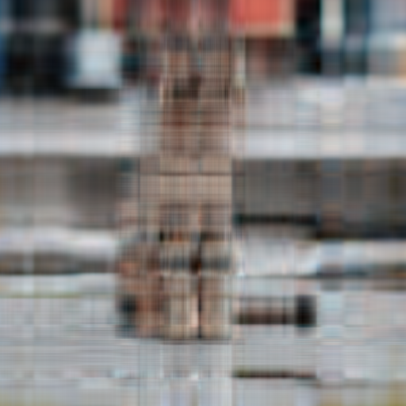

画像を2次元特異値分解し、指定ランクのLow-rank近似として再構成します。

### パラメーター

- `Low Rank (k)`: 再構成に残す特異値の数を設定します。
- `Process Width/Height`: 処理解像度を指定します。0では入力サイズを使用します。
- `RGB Only`: アルファを元画像から保持します。

### 補足

低いkほど大きな構造だけが残り、圧縮・抽象化された見た目になります。
