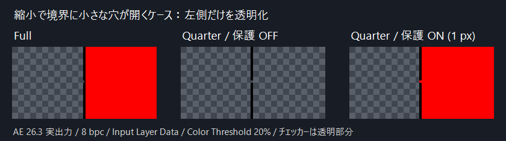

# eyedropper-mask ( AOD_EyedropperMask )

Adjusts opacity of contiguous regions around eyedropper points with per-point controls and selectable premultiplied or straight color matching.

This is the After Effects plugin **AOD_EyedropperMask**, which provides the **AOD_EyedropperMask.aex** plugin file for Adobe After Effects.

## 色と領域の判定

- **Selection Source**: 素材の原画像（Source）または上流のマスク・エフェクト適用後（Input Layer Data）から領域を判定します。既定は Input Layer Data です。
- **Color Interpretation**: 色比較にプリマルチプライ／ストレートRGBを使用します。既定は Straight です。
- 不透明度の変更は Input Layer Data に適用し、RGBとアルファを同じ比率で減らします。
- PointはAEが描画解像度に合わせて調整した座標を使用し、Smart Renderの入力・出力バッファの原点を考慮します。

## 低解像度プレビューの安定化

v0.2.2以降の **Stabilize Reduced Resolution**（既定ON）は、縮小によって境界の一部に生じる小さな穴から、選択が隣接する大きな領域へ漏れるのを抑えます。処理はHalf／Third／Quarterなどの現在のプレビュー解像度で完結し、フル解像度の画像取得・再描画は行いません。マルチフレームレンダリング対応フラグも維持しています。

色とアルファが条件を満たす候補領域を一時的に収縮させ、細い通路を切った状態でPointに接続する内部を選び、その縁だけを元の候補領域内で戻します。元の領域への無制限の再探索は行わないため、同じ穴を通って選択が再び広がることを防ぎます。

- **Preview Gap Radius (px)**: 保護半径を0〜3プレビューピクセルで指定します。既定は1です。単純な直線状の通路では、1で幅1〜2px、2で幅3〜4pxの通路を遮断します。斜めの境界や周囲の形によって結果は変わります。
- Fullでは従来の領域探索を使用します。チェックをOFFにするか半径を0にすると、縮小時も従来の探索に戻ります。
- 近似処理のため、本来つながっている細い領域も分断され、細部が選択から外れる場合があります。Point自体が非常に細い領域にある場合は、Point周辺だけを選択する保守的な動作になります。
- 境界全体が縮小で消えた場合は復元できません。保護半径を超える大きな穴も接続されたままです。Fullとの完全な一致を目指す設定ではありません。
- 各Pointの色条件に対してプレビュー全体を走査するため、保護OFFより追加の処理が必要です。処理量はプレビュー画素数・保護半径・Point数に依存します。メモリもプレビュー画素数に応じた量で、Full画像用のバッファは確保しません。

## 検証

`cargo test -p eyedropper_mask` で、1〜2pxの穴、広い通路、半径変更、完全に消えた境界、領域の縁や細い部分のPoint、アルファ条件、複数Point、Full／OFF経路、キャンセルなどに加え、連続区間の探索と通常探索の同値性（4/8近傍・細長い画像・異なる接続形状）を含む14テストを検証します。計測用の1テストは通常実行から除外しています。

[tests/resolution-smoke.jsx](tests/resolution-smoke.jsx) を候補プラグインが入った空の別AEインスタンスで実行すると、71画像と検証用プロジェクトを `target/ae-gap-test/` に出力します。既存プロジェクトを開いている場合は開始しません。MCPから実行する場合は、`AOD_EYEDROPPER_TEST_ROOT` にcheckoutの絶対パスを指定してから `$.evalFile()` で読み込みます。PNG出力が完了してから次を実行してください。

```powershell
./plugins/eyedropper-mask/tests/verify-resolution.ps1
./plugins/eyedropper-mask/tests/render-comparison.ps1
```

2026-10-27にv0.2.2をAfter Effects 2026（26.3x87）で動かし、71画像を確認しました。256×128の画像にある閉じた境界の一部が、縮小で途切れるケースを使っています。

- 8/16/32bpc、Selection Source両設定、Full／Half／Third／Quarter、保護ON/OFFで48画像を比較。OFFのThird／Quarterで隣接領域まで消え、ONでは全解像度でその領域を保持しました。FullのON/OFFは各深度・Source設定でPNGのSHA-256が一致しています。
- 半透明・両Color Interpretation、上流Fill、保護半径1／2の違いも検証しました。
- 本来の広い開口部はつながり、完全に消失した境界は復元されないことも確認しました。
- 既存の猫素材でFull／Quarterを比較しました。Fullの個別画像・アニメ分類一覧・全体一覧は既存画像とのSHA-256一致を確認しています。



### 処理時間の参考値

v0.2.2で、小さな穴から隣接領域へ漏れる再現画像を測定した結果です。Quarterは縦横1/4、画素数はFullの1/16です。

| 測定範囲 | Full | Quarter・保護OFF | Quarter・保護ON（半径1） |
|---|---:|---:|---:|
| Rustのマスク処理単体、9回中央値 | 37.738 ms | 1.785 ms | 1.851 ms |
| AEの描画＋PNG書き出し、7回中央値 | 401 ms | 290 ms | 246 ms |

Fullは2048×1024、Quarterは512×256です。処理単体はreleaseビルドで、マスク処理に必要なバッファ確保を含みます。AE側は16bpcのレンダーキューで同期描画し、最初の1回を除外、実行順を入れ替え、Thresholdを変更してエフェクト出力のキャッシュを無効化しています。素材のキャッシュは利用できます。

ON/OFFでは選択される領域の面積も変わるため、これらは保護処理だけの追加コストを測った値ではありません。ONが常にOFFより速い、または一定の倍率でFullより速いという保証はありません。上流エフェクトやPoint数、素材によって変わります。

再測定には次のテストと、専用の `gap-smoke.aep` を開いた状態で [tests/benchmark-host.jsx](tests/benchmark-host.jsx) を使用します。AE側のスクリプトは空のレンダーキューと `PNG seq (untone-map)` 出力モジュールテンプレートを前提とします。

```powershell
cargo test -p eyedropper_mask --release benchmark_preview_cost -- --ignored --nocapture
```

ROI・レイヤー境界を拡張する上流エフェクト・Premiere・MFRの同時実行負荷は今回の実機検証には含みません。

## v0.2.3の最適化と再計測

Input Layer Dataでは同じ画像の二重読み込み・色変換を省き、縮小時の領域探索では横に連続する画素をまとめて処理します。領域判定の条件と色変換式はv0.2.2と共通です。領域探索は4/8近傍を含む960条件で従来の画素単位の探索との同値性を確認しています。

2026-10-27にAE 26.3で変更前と最終候補を同じセッションで交互に描画しました。2048×1024の再現画像、Input Layer Data、1 Point、16bpc、Quarterは512×256、保護半径1です。最初の1回を除く7回の中央値を比較しています。

| 測定範囲 | v0.2.2 | v0.2.3 |
|---|---:|---:|
| Quarter・プラグイン内部の描画処理 | 2.834 ms | 2.166 ms |
| Full・プラグイン内部の描画処理 | 56.180 ms | 50.982 ms |
| Quarter・AEの描画＋PNG書き出し | 65 ms | 67 ms |
| Full・AEの描画＋PNG書き出し | 213 ms | 198 ms |

Quarterの内部処理は約24%短縮しました。一方、AE＋PNG全体では明確な短縮は確認できませんでした。エフェクト無効時も61msかかっています。この条件では100ms以下でしたが、前回の246msからの差にはAE側の実行状態による変動が大きく含まれており、最適化だけの効果とはみなしません。100ms以下をすべての素材やPoint数で保証するものではありません。

内部の時間は画像読み込み、マスク処理、出力を書き終えるまでを含みます。AEの上流画像の取得、レンダーキュー開始・終了、PNG出力、計測ログ書き込みは含みません。区間ごとの計測とエフェクト無効時の結果によって、プラグイン内部とそれ以外の時間を区別しています。

Rustの14テスト、fmt、clippy、releaseビルドを確認しました。AEの71画像はすべてv0.2.2とSHA-256が一致し、ベンチマークのFull／Quarterの16組、カタログの個別・アニメ分類・全体一覧3画像も一致しました。通常版の配布ビルドには計測ログを含めていません。

[tests/benchmark-pipeline.jsx](tests/benchmark-pipeline.jsx) は、専用の空プロジェクトで計測用の `EyedropperMaskPerfBase` と `EyedropperMaskPerfTest` を比較します。`target/ae-gap-test/benchmark.tga` と `PNG seq (untone-map)` テンプレートが必要です。結果は `target/ae-performance-test/pipeline.csv` に保存します。

計測ビルドでは `--features profile-render` と、そのAEプロセスだけに渡す `AOD_EYEDROPPER_PROFILE_PATH` を使い、読み込み・マスク・出力の時間をCSVへ記録できます。計測ログは `target/ae-performance-test/` 内を出力先にします。通常のビルドにはこのログ処理を含めません。

画質比較の再実行では、`resolution-smoke.jsx` の `AOD_EYEDROPPER_TEST_OUTPUT` に別の検証用出力フォルダー、`AOD_EYEDROPPER_TEST_MATCH_NAME` に候補のMatch Nameを指定できます。`verify-resolution.ps1 -OutputDirectory <出力フォルダー>` で確認し、以前の71画像とのハッシュを比較してください。

## ビルド

ビルド手順は[リポジトリREADME](../../README.md)を参照してください。
