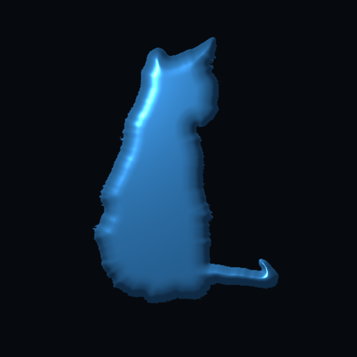

# AOD_ImageBevel

Creates curve-shaped bevels from silhouettes with configurable materials and lighting.

アルファのシルエットから距離場を作り、編集可能な断面カーブで高さ・法線・ライティングを生成するエフェクトです。表示名は `AOD_ImageBevel`、Match Name は `ImageBevel`、Windows バイナリは `AOD_ImageBevel.aex` です。



プレビューは[猫の透過シルエット](../../docs/catalog/assets/sources/cat-silhouette.png)からSDFでベベルを作り、青い材質と左上のライトを適用したAEの出力です。

## 基本操作

1. 透過画像やテキストを含むレイヤーに適用します。外側へ広げる場合は、周囲に透明な余白のあるプリコンポーズを使用してください。
2. `Direction` と `Bevel Width (px)` で断面を適用する範囲を設定します。
3. `Bevel Profile` のカーブで白黒の高さ分布を編集します。横軸が正規化した距離、縦軸が高さ（0～1）です。
4. `Output` を `Height (Grayscale)` にすると高さを確認できます。`Lit Material` で材質と光を適用します。
5. `Alpha` で元アルファ・カーブのゼロ位置・切り抜きなしを選びます。

## カーブUI

- 空白をクリックして点を追加、点をドラッグして移動します。最大16点です。
- Ctrl（macOSではCmd）を押しながら中間点をクリックすると削除します。両端点は縦方向のみ移動できます。
- `Interpolation`: 極値をはみ出さない滑らかな補間／直線補間。
- `Profile Preset`: Linear、Round、Concave、Ring、Steps。選択後に `Apply` を押すとカーブへ反映します。
- カーブはAEのArbitraryパラメーターとして保存され、Undo・プロジェクト保存・キーフレーム補間に対応します。点数が異なるキーフレーム間は16点に再サンプリングして補間します。正確な形状補間には同じ点数を推奨します。

## シルエットと高さ

| パラメーター | 動作 |
|---|---|
| Silhouette | Alpha、またはLuminance × Alphaを輪郭入力にします。RGB色領域の個別分割は行いません。 |
| Threshold | 入力値がこの値を超える画素を内側にします。 |
| Silhouette Blur | 二値化前のシルエットをぼかします。分離した3回のBoxフィルターでGaussianを近似します。 |
| Surface Method | SDF、Screened Poisson / Neumann、Screened Poisson / Dirichlet。 |
| Direction | Inner＝内側、Outer＝外側、Both＝輪郭の両側。 |
| Bevel Width | カーブ全体の幅。Bothでは内外に半分ずつ配置します。 |
| Contour Offset | 正の値で外側へ、負の値で内側へ輪郭を移動します。 |
| Height | 法線・光源位置に使う実際の高さ。負の値で凹みになります。白黒の高さ出力と切り抜きには正規化カーブ値を使います。 |
| Height Blur | カーブ適用後の高さをぼかします。カーブによる切り抜きにも反映します。 |
| Poisson Smoothing / Iterations | 平滑化の距離と反復上限。SDFモードでは無効です。 |

SDFは内側が正です。画素中心へのユークリッド距離変換を2回計算し、半画素の輪郭補正を加えます。透明な仮想外周で全不透明画像にも有限な距離を与えます。`t = clamp((distance + offset) / width + bias, 0, 1)` とし、biasはInnerで0、Outerで1、Bothで0.5です。高さは `curve(t)` になります。

Poissonは、この距離プロファイルを右辺とする `(I - r²∇²)u = t` を解いてからカーブを適用します。Neumannでは領域境界をまたぐ流束をゼロにし、Dirichletでは外側の高さをゼロにします。screen項により解の平均値は一意で、Neumannの値が反復ごとに漂流しません。Normal Generateの曲率駆動方式とは異なる、距離断面を保持する平滑化方式です。

## マテリアルと光

`Base Color`、`Diffuse`、`Roughness`、`Specular IOR Level`、`Metallic`、`IOR`、`Emission Color / Strength` を使用できます。Base Sourceを `Source x Base Color` にすると元画像の非乗算RGBを着色に使います。完全透明な場所はBase Colorのみを使います。

反射はGGX分布・Smith遮蔽・Schlick Fresnel、拡散はLambertを使用します。IOR 1.5／Specular 0.5の正面反射率は4%です。Metallicを上げると拡散と透過が減り、反射色がBase Colorへ変化します。Roughnessは反射ローブを調整し、数値安定性のため計算上の下限を0.04とします。

`Light Position` はAEのポイントコントロールです。レイヤー座標の位置と `Light Height (px)` から各画素への光の方向を計算します。`Light Color / Intensity`、`Ambient`、`Exposure (stops)` で明るさを調整します。距離減衰・影・環境マップはありません。AEのライトレイヤー参照は使用しません。

`Transmission` を上げると、法線・IOR・`Refraction Depth (px)` によって `Refraction Layer` を歪めて透過成分に使います。未選択時は入力レイヤーを参照します。IOR 1では歪みません。背景の透過画素は黒として寄与します。これは2Dの屈折近似で、ボリューム・多重反射・吸収・屈折の粗さ・背景との自動合成はありません。参照レイヤーはレイヤー座標で位置合わせするため、同サイズのプリコンポーズを推奨します。

`Output` は Lit Material／Height／Normal Map／Diffuse／Specular／Refraction。Normal MapはOpenGL形式（+Yは上）です。高さ・法線出力にはExposureを適用しません。

## アルファ

| 選択 | 動作 |
|---|---|
| Original Alpha | 元画像のアルファをそのまま使います。外側ベベルは切り落とされます。 |
| Curve Zero Cutout | ブラー後のカーブ高さがゼロになった場所を透明にします。Ringなどで穴を作れます。輪郭は局所勾配でアンチエイリアスします。 |
| No Cutout | レイヤー内のアルファを1にします。 |

カーブの左端を0より上へ動かすと、シルエット外側にも一定の高さが生まれます。完全に空の入力からは形状を生成しません。Heightを0にしても、Curve Zero Cutoutはカーブ自体のゼロ位置を使います。

出力RGBは選択したアルファで乗算します。入力・出力は8/16/32bpcに対応し、32bpcでは `Clamp Output` を無効にするとHDR値を保持します。線形作業色空間での使用を推奨します。

## 範囲・パフォーマンス

- 出力はレイヤーのキャンバス範囲です。キャンバスそのものは拡張しません。
- Smart Renderでは入力全体を取得し、タイル単位で輪郭が変わることを防ぎます。参照屈折レイヤーも全体を取得します。
- 距離・ブラー・法線・光源座標はピクセル縦横比とX/Y独立の縮小率を考慮します。輪郭の二値化によるサブピクセル差は残ります。
- CPU処理です。1件のスレッドセーフな表面キャッシュを共有し、光や材質だけの変更では形状計算を再利用します。Poissonの大きな半径・反復数では処理時間が増えます。

## ビルドと検証

```powershell
cargo test -p image_bevel
cargo clippy -p image_bevel --all-targets -- -D warnings
cargo fmt --all -- --check
$env:NO_INSTALL = "1"
just -f plugins/image-bevel/Justfile release
```

`tests/ae_smoke.jsx` を新規の専用AEインスタンスで実行すると、`target/image-bevel-smoke/` にテスト画像とAEPを保存します。既存プロジェクトに内容がある場合は中断します。カーブの追加・移動・削除、Undo、保存して開き直す操作はAE上で確認してください。

```powershell
& "C:/Program Files/Adobe/Adobe After Effects 2025/Support Files/AfterFX.com" -m -noui -ro "$PWD/plugins/image-bevel/tests/ae_smoke.jsx"
python plugins/image-bevel/tests/verify_ae_smoke.py
python plugins/image-bevel/tests/verify_windows_pipl.py target/release/AOD_ImageBevel.aex
```

画像検証にはNumPyとPillowを使用します。32bpcの`saveFrameToPng`には保存時の変換が入るため、数値比較は`sampleImage`から取得したRGBA走査線も使います。個別プレビューは16bpcです。WindowsのPiPLはバイナリファイルとして埋め込み、日本語RCコンパイラによるフラグ値の文字コード変換を回避しています。

2026-10-14にWindows／After Effects 25.6.6で確認しました。Rust単体テスト12件、fmt、Clippy、PiPLの全13プロパティ、AEの19描画条件（8/16/32bpc・アルファ3方式・内外方向・境界条件・法線・発光・HDR・屈折）が通過しています。カーブUIの追加・ドラッグ・Undo・プリセット適用を操作し、編集後の保存／再読込では出力PNGの完全一致も確認しました。Ctrl/Cmdクリックによる削除とカーブのキーフレーム補間は単体テストのみ確認済みです。macOS／他のAEバージョンは未検証です。
