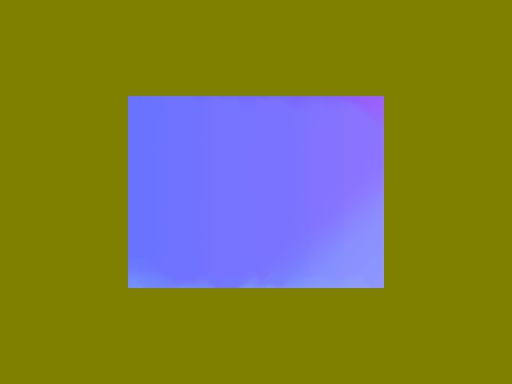

# Seam Map出力（v0.2.0）

AOD_SeamScaleの`Output`を`Seam Map (Displacement)`へ切り替えると、同じシームで画素がどこから移動してきたかをマップとして出力します。現在はユーザー確認用にSeamScaleへ統合しており、独立したAOD_SeamMapへの分離はまだ行っていません。



## AE標準エフェクトへの接続

1. プロジェクトを**32bpc**に設定します。
2. マップ元にAOD_SeamScaleを適用し、倍率・判定チャンネル・復元の設定を決め、`Output = Seam Map (Displacement)`にします。
3. マップ元を、エフェクトを含めてプリコンポーズします。マップと変形対象のピクセル寸法を揃え、レイヤーの位置・スケールも揃えます。
4. 変形対象へAE標準の`Displacement Map`を適用し、プリコンポーズしたマップを指定します。横に`Red`、縦に`Green`を選びます。
5. 最大横変位を元画像の**幅（px）**、最大縦変位を元画像の**高さ（px）**にします。512×384なら横512、縦384、1920×1080なら横1920、縦1080です。Wrap Pixels AroundとExpand OutputはOFFにします。
6. 復元OFFの縮小で余白も再現する場合は、後段の`Set Matte`で同じマップの**Blue**を使います。Composite Matte with OriginalはON、Premultiply Matte LayerはOFFにします。マップ自身のAlphaは常に不透明なので、Alphaをマットにしないでください。

マップを作った素材と別の画像へ接続すると、マップ元の内容に沿った変形を転用できます。別の画像についてシームを再計算するものではありません。

AE標準エフェクトの変位量・チャンネル選択・プリコンポーズについては[Adobeの説明](https://helpx.adobe.com/after-effects/desktop/apply-effects-and-animation-presets/list-of-effects/distort-effects.html#displacement-map-effect)も参照してください。上記の接続はAE 2025で実機確認しています。

## マップの意味

| 成分 | 意味 |
| --- | --- |
| R | 横の参照位置。0.5が変位なし。`0.5 + (元のX − 出力X) / (2 × 元の幅)`。 |
| G | 縦の参照位置。0.5が変位なし。`0.5 + (元のY − 出力Y) / (2 × 元の高さ)`。 |
| B | 有効領域。シーム処理後の画像がある場所は1、キャンバスの余白は0。元素材のアルファとは別です。 |
| A | 常に1。透明度によってR/Gのデータ値が変わるのを防ぎます。 |

縮小後の余白は`R=0.5, G=0.5, B=0, A=1`です。100%・反転なしではR/Gが全域0.5、B/Aが1です。負の倍率では参照座標も反転します。Restore Original Size=ONでは元のキャンバス全体へ座標を補間します。

シームは元のRGBAと選択したSeam Channelから従来どおり計算します。座標画像をシーム判定に使わず、XY両方向のシーム処理が終わってから座標をR/Gへ変換します。通常の`Image`出力では座標配列を作りません。

## 精度と直接出力との差

**通常のImage出力は従来どおりです。** Seam Map経由の再構成は、AE標準エフェクトの補間とマップ値の精度にも依存します。

- マップを8/16bpcで生成・処理すると、マップ値とホスト側の処理精度による誤差が生じます。32bpcのプロジェクト内でプリコンポーズして接続する方法を推奨します。
- 縮小・復元OFFなら、各出力画素に対応する元の座標を追跡できます。ただしAE標準エフェクトの有限精度により、32bpcでも微小な補間誤差が出る場合があります。
- 拡大時は、挿入画素に対応する元の座標を平均します。復元ONでも座標をバイリニア補間します。シームをまたぐと「元画像の2地点の色を混ぜること」と「2地点の中間を参照すること」は異なるため、直接Image出力との完全一致は保証しません。32bpcでもこの差は残ります。
- Bは幾何学的な有効領域です。元画像の透明度は変形対象側で保持し、必要な場合だけBを追加マットとして使います。
- マップはデータなので、色補正・トーンマッピング・圧縮などで値を変えると変位も変わります。書き出した画像を再利用する場合は、表示用PNGの見た目だけで精度を判断しないでください。

## 2026-10-19の検証

Windows、After Effects 25.6.6x4、Intel Core i9-14900KF。ユーザーによるAE終了後に配置し、AE MCPでスクリプトを実行、Computer Useで起動・出力メニュー・描画を確認しました。

- Rust自動テスト: **26件成功、計測用2件除外**。fmt、clippy、releaseビルドも成功しました。
- 通常Image出力: **156枚がv0.1.5とIHDR・展開後IDATまで完全一致**。8/16/32bpc、全7チャンネル、拡縮、反転、復元、マスク、ROIなどを含みます。
- Seam Map: 各ビット深度で9設定、計**27ケース**。素材・マップ・直接出力・AE標準エフェクトの再構成をレンダーキューから16bit PNGへ出力しました。合計84枚です。
- 27ケースすべてで、マップの不透明Alpha、Bの有効範囲、恒等変換を確認しました。32bpcの縮小・反転・0%では、AE標準エフェクトでの再構成誤差が16bit換算で最大16/65535以内でした。ビット単位の完全一致という意味ではありません。

次は64×48のテスト素材で、プリマルチプライした表示結果を比較した最大チャンネル差です。保存先PNGはStraightなので、Alpha=0に残る不可視RGBをそのまま差として数えていません。

| 32bpcの設定 | 最大差（16bit換算） |
| --- | ---: |
| 100%、反転なし | 0 / 65535 |
| XY 50%、復元OFF | 10 / 65535 |
| X 75%、Y 100%、復元OFF | 0 / 65535 |
| X −50%、Y 75%、復元OFF | 10 / 65535 |
| X −50%、Y −75%、復元OFF | 16 / 65535 |
| X 0%、Y 100%、復元OFF | 0 / 65535 |
| X 50%、Y 75%、復元ON | 15273 / 65535 |
| X 150%、Y 125%、復元OFF | 458 / 65535 |
| X 150%、Y 125%、復元ON | 1260 / 65535 |

復元・拡大で差が大きくなる例も確認しており、既知の補間上の制約として扱います。8/16bpcでも再構成差がありました。全ケースの数値は`target/seam-scale-ae-0.2.0/seam-map/verification.json`に保存しています。

`saveFrameToPng`では32bpcの出力値に表示側の変換が入ったため、最終比較にはレンダーキューの`PNG seq (untone-map)`を使いました。検証スクリプトはPNGのフィルターを展開し、16bitのRGBAを保持して比較します。今回の速度測定や4Kでのマップ出力の検証は行っていません。

## 再現手順

検証用の空プロジェクトで`tests/ae_smoke_test.jsx`を実行した後、`tests/ae_seam_map.jsx`を実行します。MCP経由では事前に`$.global.AOD_SEAM_TEST_ROOT`へworktreeの絶対パスを設定します。レンダーキュー用に`PNG seq (untone-map)`テンプレート（RGB＋Alpha、16bit PNG、Resize=OFF）が必要です。

```powershell
python plugins/seam-scale/tests/verify_ae_smoke.py target/seam-scale-ae-0.2.0
python plugins/seam-scale/tests/verify_seam_map.py target/seam-scale-ae-0.2.0/seam-map
```

今回の保存済みプロジェクトは`target/seam-scale-ae-0.2.0/seam-map/seam-map-preview.aep`です。見やすい512×384の`Preview 1 - Seam Map`、`Preview 2 - Direct Image`、`Preview 3 - Native Displacement`も用意しています。

## 配置

`C:\Program Files\Adobe\Common\Plug-ins\7.0\MediaCore\AOD_SeamScale.aex`へv0.2.0を配置済みです。274432 bytes。ビルド成果物と配置先のSHA-256は一致しています。

```text
E1AAB226539AA75FBC7DD278BB45F336664E21CB33B45941CF56F2DE7B2707E7
```

v0.1.5のバックアップは`target/seam-deployment-backups/AOD_SeamScale-before-0.2.0-20261019-214018.aex`です。今回のファイルはすべてworktree内に保存しています。通常Image出力は変わらないため、既存カタログの写真プレビュー・分類別一覧・全体一覧は維持し、Seam Map出力例と説明を追加しました。
